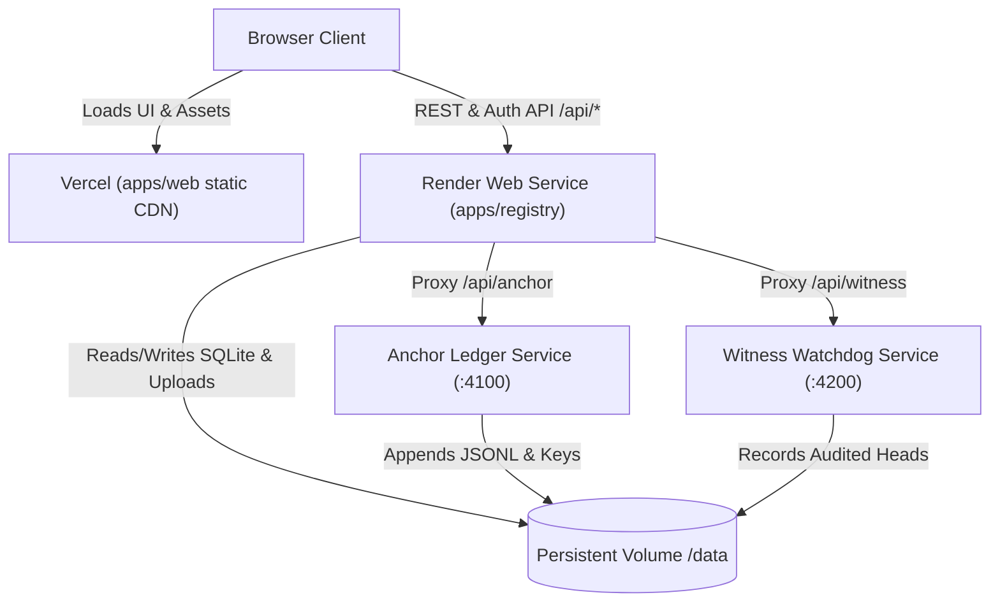

# Deployment Guide: Vercel (Frontend) + Render (Backend)

This guide walks you through deploying **ProofChain + CreatorProof** with **Vercel** hosting the React frontend and **Render** hosting the Express backend microservices.

---

## Architecture Overview

---

## Part 1: Deploy Backend to Render

1. Log into [Render Dashboard](https://dashboard.render.com).
2. Click **New +** &rarr; **Web Service**.
3. Connect your GitHub repository (`AetherMinds`).
4. In the service setup screen, configure the following:

| Field | Value |
|---|---|
| **Name** | `proofchain-backend` |
| **Language / Environment** | `Node` |
| **Branch** | `main` |
| **Root Directory** | *(leave blank - root of repo)* |
| **Build Command** | `npm install && npx tsx scripts/setup.ts` |
| **Start Command** | `npm run start:backend` |
| **Plan** | Free (or Starter if you add a persistent disk) |

5. **Environment Variables** (Click "Add Environment Variable"):

| Variable Key | Value | Description |
|---|---|---|
| `NODE_ENV` | `production` | Production mode |
| `ANCHOR_MODE` | `ledger` | Cryptographic signed ledger (no local Hardhat needed) |
| `WEB_ORIGIN` | `*` *(or your Vercel URL once created)* | Allows CORS requests |
| `REGISTRY_PORT` | `4000` | Port for registry |
| `ANCHOR_PORT` | `4100` | Port for anchor |
| `WITNESS_PORT` | `4200` | Port for witness |
| `ANCHOR_URL` | `http://127.0.0.1:4100` | Internal loopback |
| `WITNESS_URL` | `http://127.0.0.1:4200` | Internal loopback |
| `DATA_DIR` | `./data` | Directory for SQLite DB & uploads |
| `ANCHOR_DATA_DIR` | `./anchor-data` | Directory for signed ledger |
| `WITNESS_DATA_DIR` | `./witness-data` | Directory for witness state |
| `DEMO_MODE` | `true` | Allows Tamper Lab demonstrations |

6. Click **Deploy Web Service**.
7. Once deployed, copy your Render public URL (e.g., `https://proofchain-backend.onrender.com`).

---

## Part 2: Deploy Frontend to Vercel

1. Log into [Vercel Dashboard](https://vercel.com).
2. Click **Add New...** &rarr; **Project**.
3. Select and import your GitHub repository (`AetherMinds`).
4. Configure Project Settings:

| Field | Value |
|---|---|
| **Framework Preset** | `Vite` |
| **Root Directory** | `./` *(or `apps/web` if choosing subfolder)* |
| **Build Command** | `npm run build -w @proofchain/web` |
| **Output Directory** | `apps/web/dist` |

5. **Environment Variables**:
   Add this environment variable pointing to your deployed Render URL:

| Name | Value |
|---|---|
| `VITE_API_URL` | `https://proofchain-backend.onrender.com` *(your Render URL without trailing slash)* |

6. Click **Deploy**.
7. Vercel will build and assign you a live HTTPS URL (e.g. `https://proofchain.vercel.app`).

---

## Part 3: Verification & Health Check

1. Open your Vercel URL in your browser.
2. The top **System Telemetry Strip** will connect to your Render backend:
   - **Registry API**: Connected (Healthy)
   - **Anchor Ledger**: Connected (Active)
   - **Witness Watchdog**: Connected (Consistent)
3. Log in with your account or create a new user.
4. Test **Register Document** and **Verify Document** to verify end-to-end cryptographic hashing and verification!
