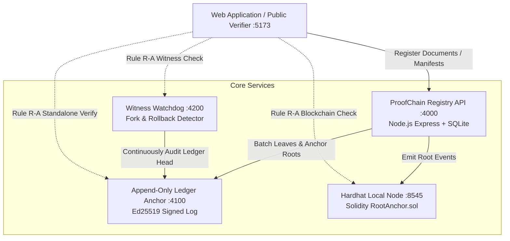

# ProofChain + CreatorProof (AetherMinds)

> **Decentralized Cryptographic Records, Tamper Detection, & Verifiable Provenance Platform**  
> *Built with TypeScript, RFC 6962 Merkle Trees, Ed25519 Signed Ledgers, Ethereum EVM Anchoring, and Local-First AI.*

---

## 🌟 Overview

**ProofChain** is a zero-trust cryptographic verification and document integrity platform designed to make digital records tamper-evident, independently verifiable, and mathematically defensible.

The platform provides a single unified cryptographic engine supporting two enterprise domains:
1. **Side 1 — Institutional ProofChain**: Official document registration for universities, government agencies, and enterprises (degrees, certificates, titles, contracts). Every registered file is fingerprinted via SHA-256, batched into RFC 6962 domain-separated Merkle trees, and pinned to both an append-only Ed25519-signed ledger and an Ethereum EVM smart contract.
2. **Side 2 — CreatorProof**: Provenance and attribution infrastructure for digital artists, writers, and creators. Creators sign cryptographic manifests using browser-managed Ed25519 keypairs, link derivative versions into immutable version graphs, and share public verifiable certificate pages.

---

## 🛡️ Core Architectural Rules

ProofChain enforces three strict architectural invariants:

* **Rule R-A: The Verifier Never Trusts the Database**  
  The public verifier evaluates document authenticity strictly using the file bytes, the standalone `.pcproof.json` receipt, the append-only Ledger Anchor (`:4100`), the Witness Watchdog (`:4200`), and Ethereum (`:8545`). It **never** trusts or queries the central database for cryptographic verdicts.
* **Rule R-B: Zero AI in the Verification Path**  
  Verification is 100% deterministic mathematics (SHA-256 collision resistance, Merkle tree traversal, Ed25519 signature checks). AI is strictly restricted to extraction, suggestions, and post-verification natural language explanation.
* **Rule R-C: Integrity & Priority of Registration**  
  The system proves *unbroken content integrity* and *priority of timestamped registration*. It presents cryptographic evidence rather than ungrounded claims of physical identity.

---

## 🚀 Key Features & Modules

### 1. Independent Public Verifier (`/verify`)
* **Instant 1-Click Verification**: Upload or drag any document to instantly calculate its SHA-256 digest and cross-reference the decentralized anchor ledger.
* **Metadata & Filename Integrity Check**: Detects if a document's content is authentic but its filename was altered, instantly flagging `FILENAME_MISMATCH` to prevent deceptive renames.
* **Standalone Portable Receipts**: Drop `.pcproof.json` bundles alongside the document for pure offline, air-gapped verification without relying on network APIs.
* **Audit Trail Breakdown**: Displays step-by-step verification stages with execution timings and natural-language summaries.

### 2. Institutional Document Registration (`/proofchain/register`)
* **Multi-File Batch Registration**: Upload PDFs, credentials, contracts, and images.
* **Local-First AI Metadata Extraction**: Extracts document titles, dates, institutions, and categories using browser heuristics and Naive Bayes models.
* **Client-Side Domain Hashing**: Computes both raw content SHA-256 ($H_{doc}$) and RFC 6962 leaf hashes ($H_{leaf} = \text{SHA-256}(0x00 \ || \ H_{doc})$) before transmission.
* **Automatic Batch Sealing**: Immediately seals and anchors pending batches so records are verifiably anchored without delays.

### 3. Adversarial Security Laboratory (`/proofchain/tamper`)
* **Scenario 1: 1-Bit Document Alteration (`DOC_MODIFIED`)**: Select any live registered document and invert exactly 1 bit. Real-time metrics compute the **Avalanche Effect** (flipping ~128 out of 256 bits) to demonstrate why targeted forgery is computationally impossible.
* **Scenario 2: Merkle Tree Proof Forgery (`ROOT_MISMATCH`)**: Loads real `.pcproof.json` receipts, corrupts sibling hashes, and demonstrates client-side tree recalculation rejection against the pinned Ed25519 ledger root.
* **Scenario 3: Rogue Admin Database Drift (`REGISTRY_DRIFT`)**: Simulates unauthorized direct SQLite mutations (modifying batch roots, deleting records, altering leaf hashes). Triggers the live **Continuous Drift Audit Engine** to catch discrepancies between the database and the immutable ledger.

### 4. Creator Provenance & Attribution (`/creator`)
* **Browser Ed25519 Key Management**: Generates and securely stores creator keypairs in the browser.
* **Cryptographically Signed Manifests**: Signs metadata, licensing, and file fingerprints with Ed25519.
* **Versioned Work Lineage**: Links revised files back to parent leaf hashes to prove creation progression.
* **Public Certificate & Evidence Panel**: Shareable certificate pages with QR codes and competing-claim panels.

### 5. Ledger & Batch Explorer (`/proofchain/batches`)
* **Interactive Merkle Visualizer**: Inspects Merkle levels from leaf hashes up to the batch root.
* **Anchor Ledger Feed**: View cryptographic sequence numbers, Ed25519 signatures, and EVM transaction hashes.

---

## 📐 System Architecture



---

## 💻 Tech Stack

| Layer | Technologies |
| :--- | :--- |
| **Monorepo** | npm workspaces, TypeScript 5.x |
| **Frontend** | React 19, Vite 5, Tailwind CSS, Lucide Icons |
| **Backend Services** | Node.js (v20/v22), Express 4, `node:sqlite` (DatabaseSync) |
| **Cryptography** | `@noble/hashes` (SHA-256, Keccak-256), `@noble/curves` (Ed25519) |
| **Blockchain** | Solidity `^0.8.20`, Hardhat local chain, ethers.js v6 |
| **Local AI** | Heuristic rules, Naive Bayes classifier, optional Ollama LLM integration |
| **Testing** | Vitest (17 suites, 157 automated tests) |

---

## 📁 Repository Structure

```
AetherMinds/
├── apps/
│   ├── web/                 # React + Vite frontend application
│   ├── registry/            # Central registry API & SQLite storage (:4000)
│   ├── anchor/              # Append-only Ed25519 signed ledger service (:4100)
│   ├── witness/             # Independent watchdog auditing anchor consistency (:4200)
│   └── chain/               # Solidity contract, Hardhat node & EVM anchor (:8545)
├── contracts/               # RootAnchor.sol smart contract
├── packages/
│   ├── core/                # Merkle tree math, RFC 6962, bundle schema, crypto primitives
│   ├── verifier/            # Rule R-A standalone verifier engine & anchor readers
│   └── ai/                  # Document categorizer, text extractors, safety guards
├── scripts/
│   └── setup.ts             # Deterministic setup script (generates keys & .env)
└── package.json             # Monorepo workspaces manifest
```

---

## ⚙️ Getting Started

### Prerequisites
* **Node.js**: `v20.x` or `v22.x`
* **npm**: `v10.x` or later

### Installation & Setup

1. **Clone the repository**:
   ```bash
   git clone https://github.com/Lokesh19-PP/AetherMinds.git
   cd AetherMinds
   ```

2. **Install dependencies**:
   ```bash
   npm install
   ```

3. **Initialize environment & cryptographic keys**:
   ```bash
   npm run setup
   ```
   *Generates fresh Ed25519 anchor keys, configures `.env`, and pins the public key into the verifier package.*

### Running the Platform

Run all services concurrently:
```bash
npm run dev
```

This starts:
- 🌐 **Web Frontend**: `http://localhost:5173`
- 🏛️ **Registry API**: `http://localhost:4000`
- 🛡️ **Anchor Service**: `http://localhost:4100`
- 👁️ **Witness Service**: `http://localhost:4200`

*(Optional)* Start the local Ethereum node and deploy the contract:
```bash
npm run node -w @proofchain/chain
npm run deploy -w @proofchain/chain
```

---

## 🧪 Testing

Run the full end-to-end test suite:
```bash
npm test
```
Executes all **17 test suites** (157 unit and integration tests) validating:
- SHA-256 and RFC 6962 Merkle tree construction
- Standalone verifier purity under Rule R-A
- Ed25519 signature validity and fail-closed rejections
- Witness fork, rollback, and bad-signature detection
- Database drift audit engine execution

---

## 📋 Verification Codes Reference

| Code | Status | Meaning |
| :--- | :--- | :--- |
| `VALID` | Pass | Document content, Merkle path, and anchor signature are 100% authentic. |
| `DOC_MODIFIED` | Rejected | Document content hash does not match the leaf recorded in the batch. |
| `FILENAME_MISMATCH` | Rejected | Content matches, but filename was altered from its authentic registration. |
| `ROOT_MISMATCH` | Rejected | Recomputed Merkle root from proof bundle differs from the signed anchor root. |
| `ANCHOR_INVALID` | Rejected | Ed25519 signature on the ledger entry is mathematically invalid. |
| `ANCHOR_FORK` | Rejected | Witness detected that the anchor presented conflicting entries for the same sequence. |
| `REGISTRY_DRIFT` | Alert | Central database was altered behind the scenes and diverged from the immutable ledger. |

---

## 📄 License

MIT License. Designed and developed by the **AetherMinds** team.